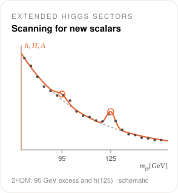
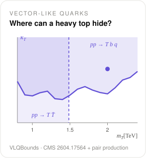
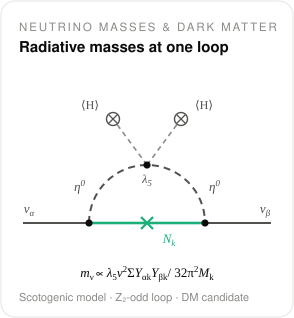
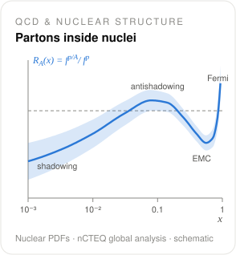
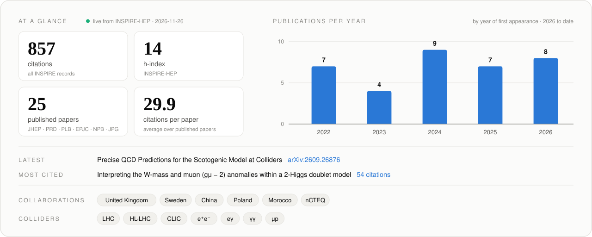

<picture>
  <source media="(prefers-color-scheme: dark)" srcset="assets/header-dark.svg">
  
</picture>

  
  
  
  
  
  

## About me

I'm **Mohammed Boukidi** (Simo to my colleagues), a theoretical particle physicist and
postdoctoral researcher at the **Institute of Nuclear Physics, Polish Academy of Sciences
(IFJ PAN)** in Kraków, where I am part of the **nCTEQ** collaboration. I completed my
Ph.D. at Cadi Ayyad University in Morocco in 2024.

I study what might lie beyond the Standard Model of particle physics, and how we would
recognise it in real data. My work follows three steps: build a model, predict precisely
what it would produce at a collider, and compare those predictions with the measurements
of the ATLAS and CMS experiments at the LHC.

Along the way I write open-source software that makes these comparisons fast and
reproducible, so that other physicists can test their own ideas against the same data.
I enjoy working across communities, with model builders, experimentalists and QCD
specialists alike, and I am always glad to talk about a new idea.

## The questions I work on

### Is there more than one Higgs boson?

<picture>
  <source media="(prefers-color-scheme: dark)" srcset="assets/panel-higgs-dark.svg">
  
</picture>

The Higgs boson found in 2012 may have relatives. I study two-Higgs-doublet models and their extensions: charged and doubly charged Higgs bosons, the hints of new scalars around 95 GeV and 650 GeV, and what the LHC and future colliders would need to see them.

[JHEP 05 (2024) 209](https://arxiv.org/abs/2306.09029) · [Nucl. Phys. B 1005 (2024) 116593](https://arxiv.org/abs/2204.11755) · [Phys. Rev. D 113 (2026) 055028](https://arxiv.org/abs/2510.19605)

 

### Where can a heavy partner of the top quark still hide?

<picture>
  <source media="(prefers-color-scheme: dark)" srcset="assets/panel-vlq-dark.svg">
  
</picture>

Vector-like quarks appear in many theories that try to explain why the Higgs is light. I combine every relevant ATLAS and CMS search to map where they are excluded and where they could still be, and I built [VLQBounds](https://github.com/BSMTools/VLQBounds) so anyone can put the same question to their own model.

[JHEP 03 (2025) 020](https://arxiv.org/abs/2412.01761) · [arXiv:2605.20848](https://arxiv.org/abs/2605.20848) · [Phys. Rev. D 111 (2025) 095026](https://arxiv.org/abs/2407.01348)

 

### Could the particle behind neutrino masses be the dark matter?

<picture>
  <source media="(prefers-color-scheme: dark)" srcset="assets/panel-nu-dark.svg">
  
</picture>

In the Scotogenic model neutrinos get their mass from a loop of new particles, and the lightest of them is a dark-matter candidate. I compute how these particles would be produced at the LHC and at a 100 TeV collider, at next-to-leading order in QCD, and test the model against neutrino-oscillation and flavour data.

[arXiv:2609.26876](https://arxiv.org/abs/2609.26876)

 

### What do quarks and gluons look like inside a nucleus?

<picture>
  <source media="(prefers-color-scheme: dark)" srcset="assets/panel-qcd-dark.svg">
  
</picture>

A proton bound in a nucleus is not a free proton: its quarks and gluons are reshuffled, suppressed at small momentum fraction and enhanced or depleted at larger ones. With nCTEQ I work on the global analyses that extract these nuclear parton distributions from data, the input behind every proton–nucleus and heavy-ion prediction.

[nCTEQ collaboration](https://ncteq.hepforge.org/)

 

## Software

<table>
<tr>
<td width="56%" valign="top">

#### [VLQBounds](https://github.com/BSMTools/VLQBounds)
Tells you in one call whether a vector-like-quark model is excluded by the LHC: 260 ATLAS
and CMS limits from 64 analyses, the most sensitive search for every point, and physics
regression tests against the published numbers.

#### ScotoPy &nbsp;public release with the paper
Scotogenic-model phenomenology in Python: spectrum and decays consistent with the UFO
used in event generation, radiative neutrino masses, lepton-flavour violation and
electroweak precision, and an NLO QCD model for MadGraph5_aMC@NLO.

</td>
<td width="44%" valign="top">

</td>
</tr>
</table>

**Daily tools:** Python (NumPy, SciPy, pandas, Matplotlib, pytest) · MadGraph5_aMC@NLO · FeynRules · LHAPDF · APFEL++ · MCMC · LaTeX and TikZ-Feynman · Git and GitHub Actions

## Selected papers

- **VLQBounds: Confronting Vector-Like Quark Models with LHC Searches** — [arXiv:2605.20848](https://arxiv.org/abs/2605.20848) (2026)
- **Precise QCD Predictions for the Scotogenic Model at Colliders** — [arXiv:2609.26876](https://arxiv.org/abs/2609.26876) (2026)
- **Vector-Like Quarks at the LHC: A Unified Perspective from ATLAS and CMS Exclusion Limits** — [*JHEP* 03 (2025) 020](https://arxiv.org/abs/2412.01761)
- **Explanation of the Hints for a 95 GeV Higgs Boson within a 2-Higgs Doublet Model** — [*JHEP* 05 (2024) 209](https://arxiv.org/abs/2306.09029)
- **Interpreting the W-Mass and Muon (g−2) Anomalies within a 2-Higgs Doublet Model** — [*Nucl. Phys. B* 1005 (2024) 116593](https://arxiv.org/abs/2204.11755)

<b>All publications</b>

#### 2026
- Precise QCD Predictions for the Scotogenic Model at Colliders — [arXiv:2609.26876](https://arxiv.org/abs/2609.26876)
- Can γγ collisions rival e⁺e⁻ in probing doubly charged Higgs bosons? — *Phys. Rev. D* **114** (2026) 095022 · [arXiv:2608.18023](https://arxiv.org/abs/2608.18023)
- Sensitivity to Single Vector-Like Bottom Quark Production at 3 TeV CLIC — *Phys. Rev. D* **114** (2026) 053006 · [arXiv:2608.15134](https://arxiv.org/abs/2608.15134)
- VLQBounds: Confronting Vector-Like Quark Models with LHC Searches — [arXiv:2605.20848](https://arxiv.org/abs/2605.20848)
- Impact of hidden heavy Higgs channels of VLB-Quarks below 1 TeV in 2HDM — *Nucl. Phys. B* **1026** (2026) 117436 · [arXiv:2604.07161](https://arxiv.org/abs/2604.07161)
- Probing Heavy Neutral Higgs Bosons via Single Vector-Like Bottom Quark Production at the HL-LHC — *Phys. Lett. B* **879** (2026) 140701 · [arXiv:2603.29076](https://arxiv.org/abs/2603.29076)
- Probing Doubly Charged Higgs Bosons with Three-Body Associated Production at Future e⁺e⁻ Colliders — *Phys. Rev. D* **113** (2026) 095038 · [arXiv:2602.19866](https://arxiv.org/abs/2602.19866)
- Single Production of a Vector-Like Top as a Probe of Charged Higgs Bosons at a Muon-Proton Collider — *Eur. Phys. J. C* **86** (2026) 511 · [arXiv:2601.07758](https://arxiv.org/abs/2601.07758)
- Interpreting the 650 GeV and 95 GeV Higgs anomalies in the next-to-two-Higgs-doublet model — *Phys. Rev. D* **113** (2026) 055028 · [arXiv:2510.19605](https://arxiv.org/abs/2510.19605)

#### 2025
- Relaxing vector-like top quark mass limits through exotic decays in the type-II two-Higgs-doublet model — [*Eur. Phys. J. C* **85** (2025) 1275](https://inspirehep.net/literature?q=j%20Eur.Phys.J.C%2C85%2C1275)
- Exploring Potential Higgs Resonances at 650 GeV and 95 GeV in the 2HDM Type III — *Phys. Lett. B* **868** (2025) 139688 · [arXiv:2505.07811](https://arxiv.org/abs/2505.07811)
- Exploring vector-like top quark pair production via charged Higgs decays in multi-b-jet and opposite-sign dilepton final state at the LHC — [*Eur. Phys. J. C* **85** (2025) 500](https://inspirehep.net/literature?q=j%20Eur.Phys.J.C%2C85%2C500)
- Vector-Like Quarks at the LHC: A Unified Perspective from ATLAS and CMS Exclusion Limits — *JHEP* **03** (2025) 020 · [arXiv:2412.01761](https://arxiv.org/abs/2412.01761)
- Large Hadron Collider Signatures of Exotic Vector-Like Quarks within the 2-Higgs Doublet Model Type-II — *J. Phys. G* **52** (2025) 105002 · [arXiv:2409.20104](https://arxiv.org/abs/2409.20104)
- Investigation of Charged Higgs Bosons Production from Vector-Like T Quark Decays at eγ Collider — *Phys. Rev. D* **111** (2025) 015027 · [arXiv:2408.15985](https://arxiv.org/abs/2408.15985)
- Search for Charged Higgs Bosons through Vector-Like Top Quark Pair Production at the LHC — *Phys. Rev. D* **111** (2025) 095026 · [arXiv:2407.01348](https://arxiv.org/abs/2407.01348)
- Anatomy of Vector-Like Top-Quark Models in the Alignment Limit of the 2-Higgs Doublet Model Type-II — *Eur. Phys. J. C* **85** (2025) 2 · [arXiv:2401.16219](https://arxiv.org/abs/2401.16219)

#### 2024
- Superposition of CP-Even and CP-Odd Higgs Resonances: Explaining the 95 GeV Excesses within a Two-Higgs Doublet Model — *Phys. Rev. D* **110** (2024) 115030 · [arXiv:2405.02899](https://arxiv.org/abs/2405.02899)
- Anatomy of Vector-Like Bottom-Quark Models in the Alignment Limit of the 2-Higgs Doublet Model Type-II — *Eur. Phys. J. C* **84** (2024) 1008 · [arXiv:2403.13021](https://arxiv.org/abs/2403.13021)
- Explanation of the Hints for a 95 GeV Higgs Boson within a 2-Higgs Doublet Model — *JHEP* **05** (2024) 209 · [arXiv:2306.09029](https://arxiv.org/abs/2306.09029)
- The oblique parameters in the 2HDM with Vector-Like Quarks: Confronting MW CDF-II Anomaly — *J. Phys. G* **51** (2024) 075001 · [arXiv:2302.07149](https://arxiv.org/abs/2302.07149)
- Probing Light Charged Higgs Bosons in the 2-Higgs Doublet Model Type-II with Vector-Like Quarks — *Phys. Rev. D* **109** (2024) 055016 · [arXiv:2211.07259](https://arxiv.org/abs/2211.07259)
- Interpreting the W-Mass and Muon (g−2) Anomalies within a 2-Higgs Doublet Model — *Nucl. Phys. B* **1005** (2024) 116593 · [arXiv:2204.11755](https://arxiv.org/abs/2204.11755)

#### 2023
- Search for single production of vector-like top partner T → H⁺b and H± → tb̄ at the LHC Run-III — [*Phys. Lett. B* **843** (2023) 138024](https://inspirehep.net/literature?q=j%20Phys.Lett.B%2C843%2C138024)
- Higgs-like particle decays into γZ and γγ: Fingerprints of some non-supersymmetric models — *Nucl. Phys. B* **990** (2023) 116154 · [arXiv:2211.12546](https://arxiv.org/abs/2211.12546)

#### 2022
- Explaining the 96 GeV Di-photon Anomaly in a Generic 2HDM Type-III — *Phys. Lett. B* **832** (2022) 137245 · [arXiv:2204.07470](https://arxiv.org/abs/2204.07470)

#### Conference proceedings
- Probing a Vector-like Top Quark T → H⁺b and H⁺ → tb̄ at HL-LHC — *Springer Proc. Phys.* **425** (2025) 159
- Interpreting the Indications of a 95 GeV Higgs Boson Through a 2-Higgs Doublet Model — *Springer Proc. Phys.* **425** (2025) 165
- Probing Single Production of Vector-Like T Quarks through the T → H⁺b Decay Mode with H⁺ → tb at the HL-LHC — *PoS* ICHEP2024 (2025) 324
- Charged Higgs Boson Mass Bounds in 2HDM-II: Impact of Vector-Like Quarks — *PoS* ICHEP2024 (2025) 083 · [arXiv:2409.16054](https://arxiv.org/abs/2409.16054)
- Probing 95 GeV Higgs in the 2HDM Type-III — *PoS* LHCP2023 (2024) 299 · [arXiv:2402.03998](https://arxiv.org/abs/2402.03998)
- Identifying light charged Higgs boson in the μν channel in 2HDM Type-III — *PoS* LHCP2022 (2023) 234 · [arXiv:2211.11288](https://arxiv.org/abs/2211.11288)
- Probing a 96 GeV Higgs Boson in the Di-Photon Channel at the LHC — *PoS* ICHEP2022 (2022) 547 · [arXiv:2211.11140](https://arxiv.org/abs/2211.11140)
- Search for charged Higgs boson in μν channel within 2HDM type-III — [arXiv:2206.03897](https://arxiv.org/abs/2206.03897)

#### Book chapter
- Phenomenology of Heavy Quark at the LHC — in *Quantum Entanglement in High Energy Physics* (2023)

#### Collaboration reports
- CEPC Technical Design Report: Accelerator — *Radiat. Detect. Technol. Methods* **8** (2024) 1 · [arXiv:2312.14363](https://arxiv.org/abs/2312.14363)
- CEPC Technical Design Report — Reference Detector — [arXiv:2510.05260](https://arxiv.org/abs/2510.05260)

Complete and up-to-date list with citations: [INSPIRE-HEP](https://inspirehep.net/authors/1990553).

## In numbers

<picture>
  <source media="(prefers-color-scheme: dark)" srcset="assets/glance-dark.svg">
  
</picture>

Refreshed every day from the <a href="https://github.com/inspirehep/rest-api-doc">INSPIRE-HEP API</a> by a GitHub Action.

## My path

<picture>
  <source media="(prefers-color-scheme: dark)" srcset="assets/path-dark.svg">
  
</picture>

**Collaboration:** nCTEQ &nbsp;·&nbsp; **Service:** referee for *The European Physical Journal C* &nbsp;·&nbsp;
**Recent talks:** Collider Physics 2026 (Katowice), ICHEP 2024, LHCP 2023, LHCP 2022, ICHEP 2022

## Let's talk

I'm always happy to talk physics: a new collaboration, a question about one of the
papers, or a seminar on extended Higgs sectors, vector-like quarks, precision
predictions for new physics, or open tools for reinterpreting LHC results.

  <a href="https://www.linkedin.com/in/mohammed-boukidi-34375915b/">LinkedIn</a> &nbsp;·&nbsp; <a href="https://inspirehep.net/authors/1990553">INSPIRE-HEP</a> &nbsp;·&nbsp;
  <a href="https://orcid.org/0000-0001-9961-8772">ORCID</a> &nbsp;·&nbsp; <a href="https://github.com/BSMTools">BSMTools</a>

